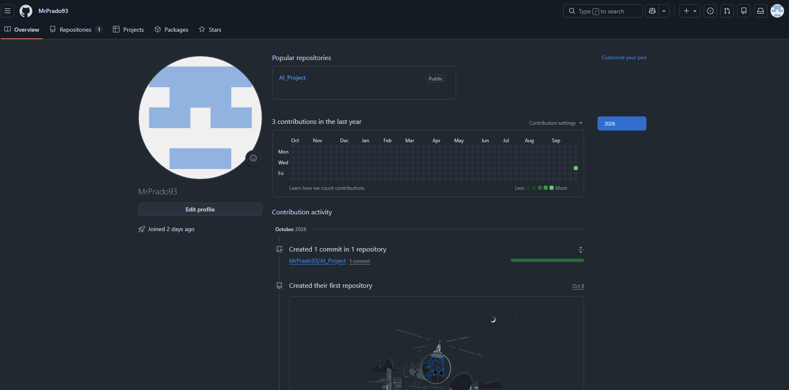
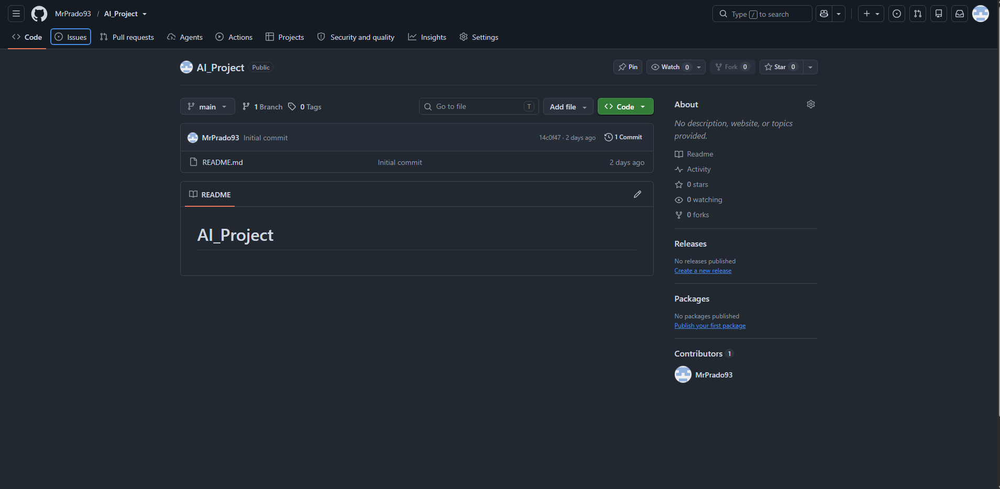
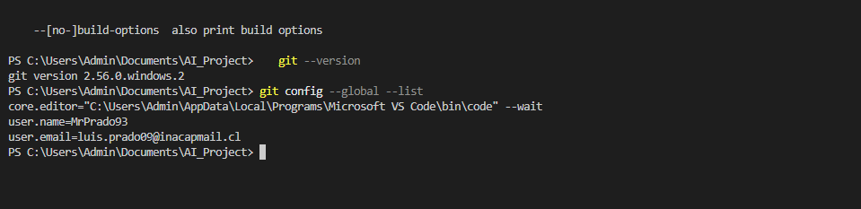
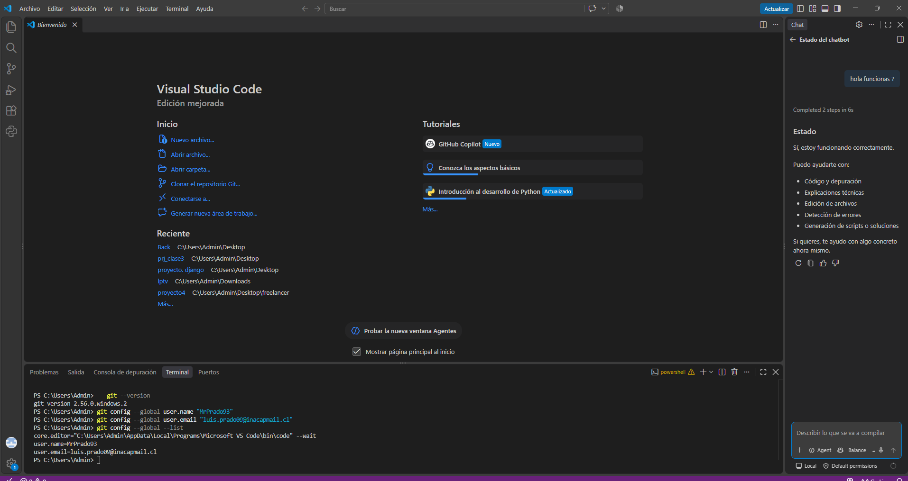
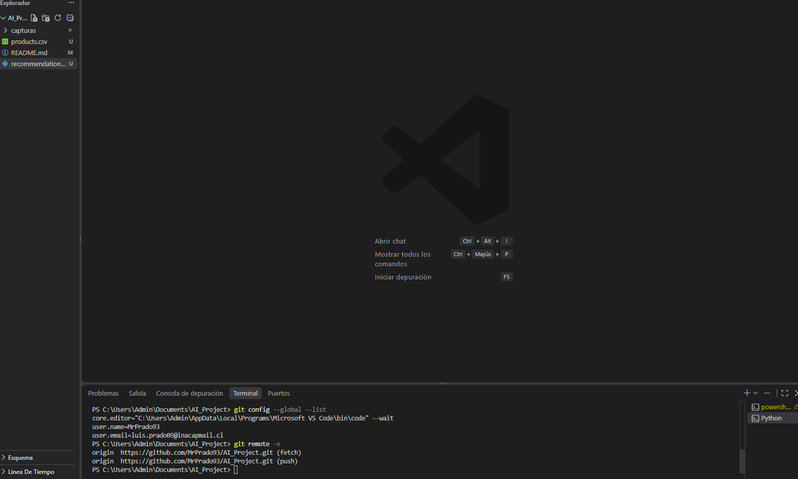
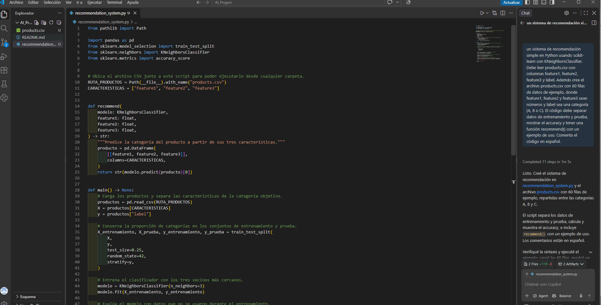
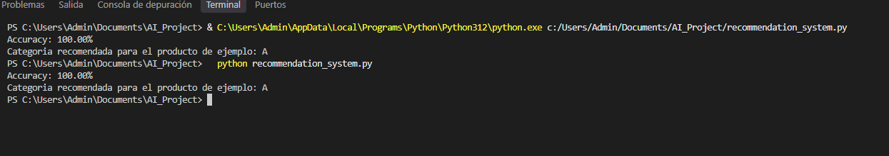
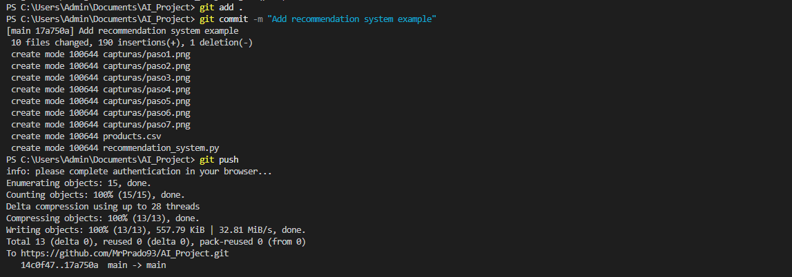

# AI_Project: Sistema de recomendación con GitHub Copilot

**Alumno:** Luis 

**Institución:** INACAP

**Actividad:** Actividad formativa – GitHub Copilot

## Descripción
Proyecto que usa GitHub Copilot para generar un sistema de recomendación simple en Python.
El modelo usa el algoritmo K vecinos más cercanos (KNeighborsClassifier de scikit-learn)
para clasificar productos en las categorías A, B o C según tres características numéricas.

## Paso 1: Creación de la cuenta en GitHub
Creé mi cuenta en github.com con mi correo institucional y la validé con el código enviado al correo.

## Paso 2: Creación del repositorio
Creé el repositorio AI_Project como público, con un archivo README inicial.

## Paso 3: Instalación y configuración de Git
Instalé Git para Windows, eligiendo Visual Studio Code como editor por defecto.
Luego configuré mi nombre y correo con `git config`.

## Paso 4: Conexión de GitHub Copilot
Inicié sesión con mi cuenta de GitHub en Visual Studio Code y activé Copilot.
Comprobé que funcionaba enviándole un mensaje en el chat.

## Paso 5: Clonar el repositorio
Cloné el repositorio en mi computador con:

    git clone https://github.com/MrPrado93/AI_Project.git

y abrí la carpeta en Visual Studio Code.

## Paso 6: Generación del código con Copilot
Creé el archivo recommendation_system.py y le pedí a Copilot, en modo Agent, que generara
el sistema de recomendación y un archivo products.csv con 60 filas de datos de ejemplo.

## Paso 7: Ejecución del programa
Instalé las librerías necesarias con:

    python -m pip install numpy pandas scikit-learn

y ejecuté el programa con `python recommendation_system.py`. El programa muestra el
accuracy del modelo y una recomendación de ejemplo.

## Paso 8: Subir los cambios a GitHub
Agregué los archivos, hice commit y los subí al repositorio remoto con:

    git add .
    git commit -m "Add recommendation system example"
    git push

## Conclusión
GitHub Copilot permitió generar rápidamente un código funcional a partir de una
descripción en lenguaje natural, lo que muestra cómo la IA se está integrando en
las herramientas de desarrollo. Aun así, es importante revisar y entender el
código generado antes de usarlo.git add .